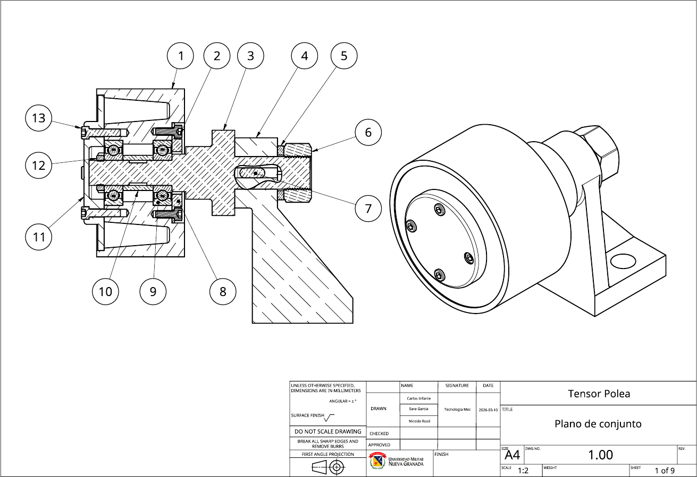
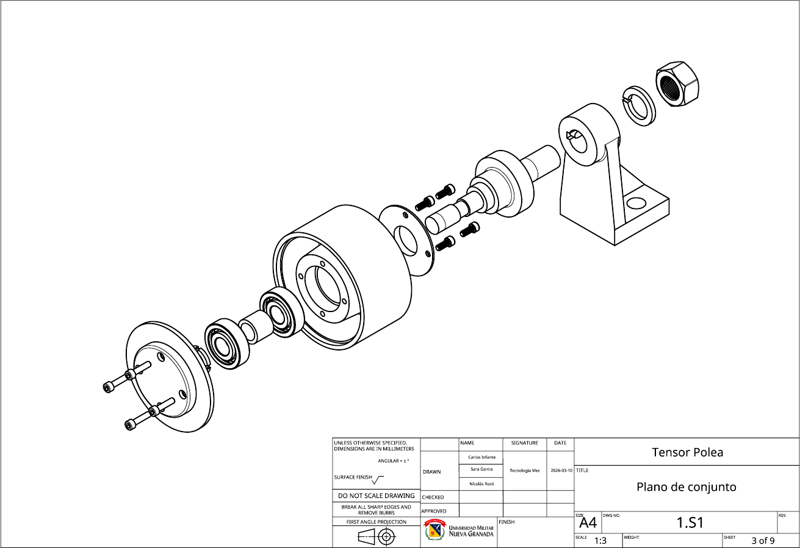
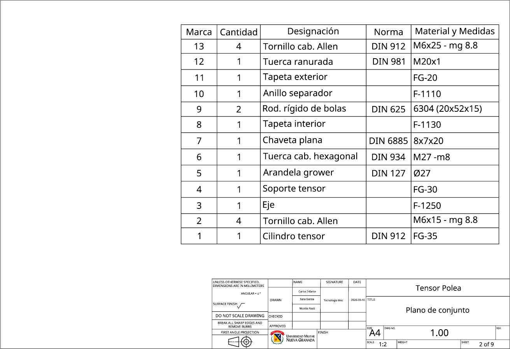
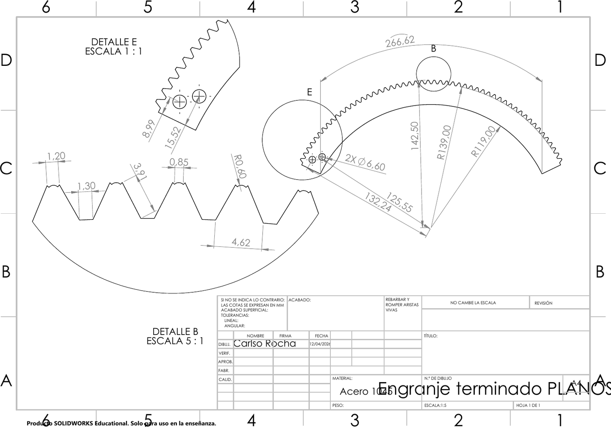

# Mechanical Design Portfolio: SolidWorks

3D CAD models and engineering drawings from my mechatronics coursework: part modeling, assemblies, and manufacturing drawings that follow standards (first-angle projection, section views, detail views, bills of materials with DIN parts).

## 1. Belt tensioner pulley: full assembly drawing set · `belt-tensioner/`

A 9-sheet drawing package (A4, first-angle projection) for an idler pulley that tensions a belt. Team project of 3 students, Mechanical Technology course.

- **Assembly drawing** with a full section view, showing the shaft, two **6304 deep-groove ball bearings** (DIN 625), spacer ring, inner and outer covers, slotted nut (DIN 981) and lock washer (DIN 127).
- **Bill of materials** with 13 items, standards and materials, plus an **exploded view**.
- **Part drawings** of the tensioner cylinder, shaft, bracket, covers and spacer, with tolerances and sections.

  

  
  

## 2. Gear segment · `gear-segment/`

A toothed gear segment (sector) modeled in SolidWorks, with a manufacturing drawing that includes detail views at 1:1 and 5:1 of the tooth profile, radii and mounting holes. Material: steel.

## 3. ResQBot · `resqbot/`

A concept model of a rescue robot. It includes the body, internal frame, doors with tube, propeller part, and a wheel sub-assembly (rim + tire), all assembled in `EnsamblajeResqBot.SLDASM`.

## Files

| Folder | Formats |
|---|---|
| `belt-tensioner/` | PDF drawing set (9 sheets) |
| `gear-segment/` | `.SLDPRT` + PDF drawing |
| `resqbot/` | `.SLDPRT` parts and `.SLDASM` assemblies (SolidWorks 2024) |

---

<b>🇪🇸 Versión en español</b>

## Portafolio de diseño mecánico (SolidWorks)

- **Tensor de polea:** juego de 9 planos con vista en corte del conjunto, rodamientos 6304, lista de materiales con piezas normalizadas DIN, vista explosionada y planos de cada pieza. Trabajo en grupo de 3, Tecnología Mecánica.
- **Segmento de engranaje:** pieza y plano de fabricación con detalles del perfil del diente.
- **ResQBot:** modelo conceptual de un robot de rescate, con piezas y ensamblajes.

